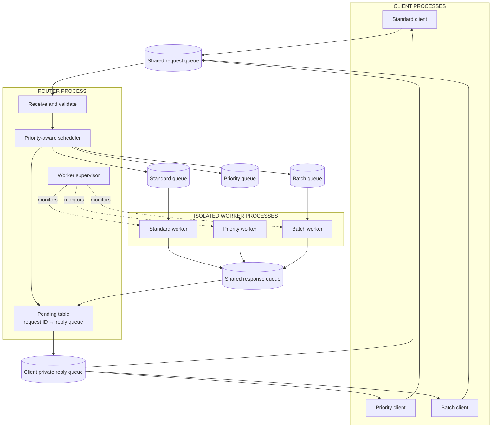
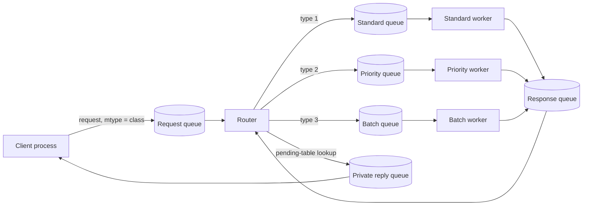
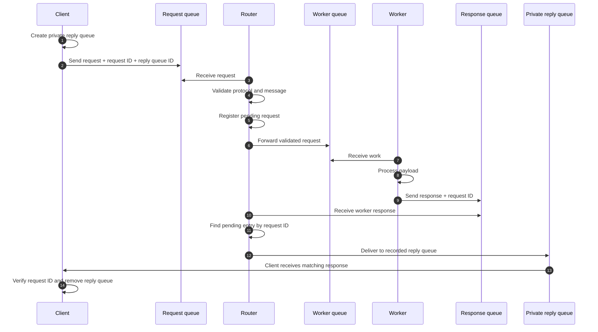
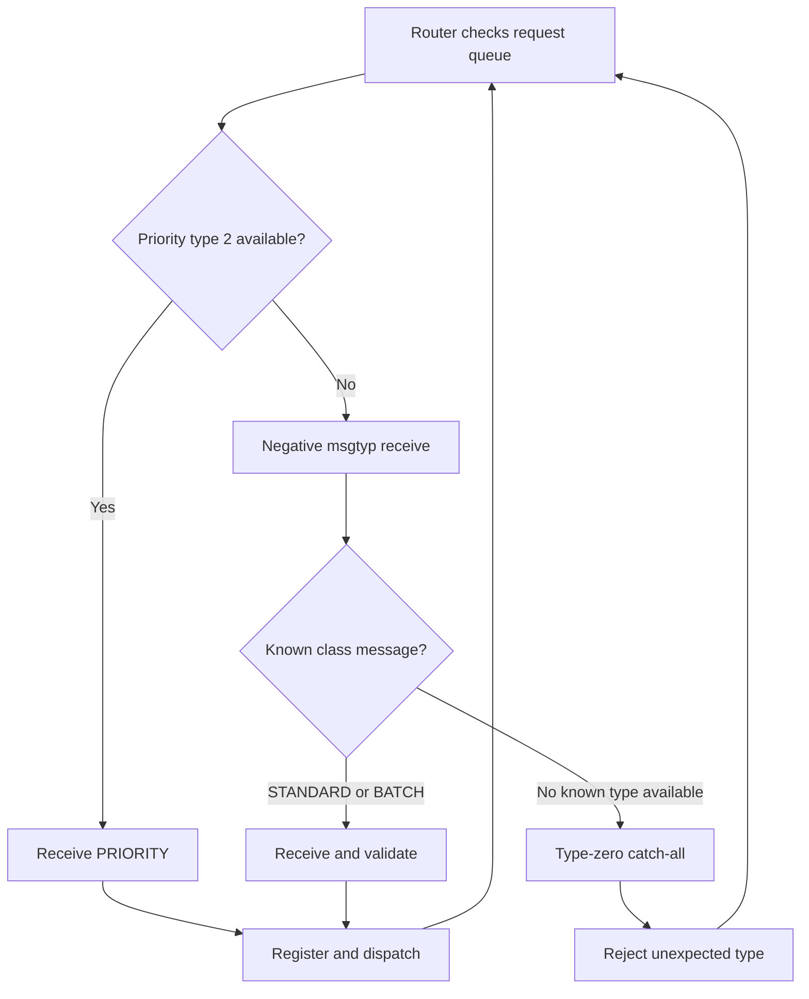
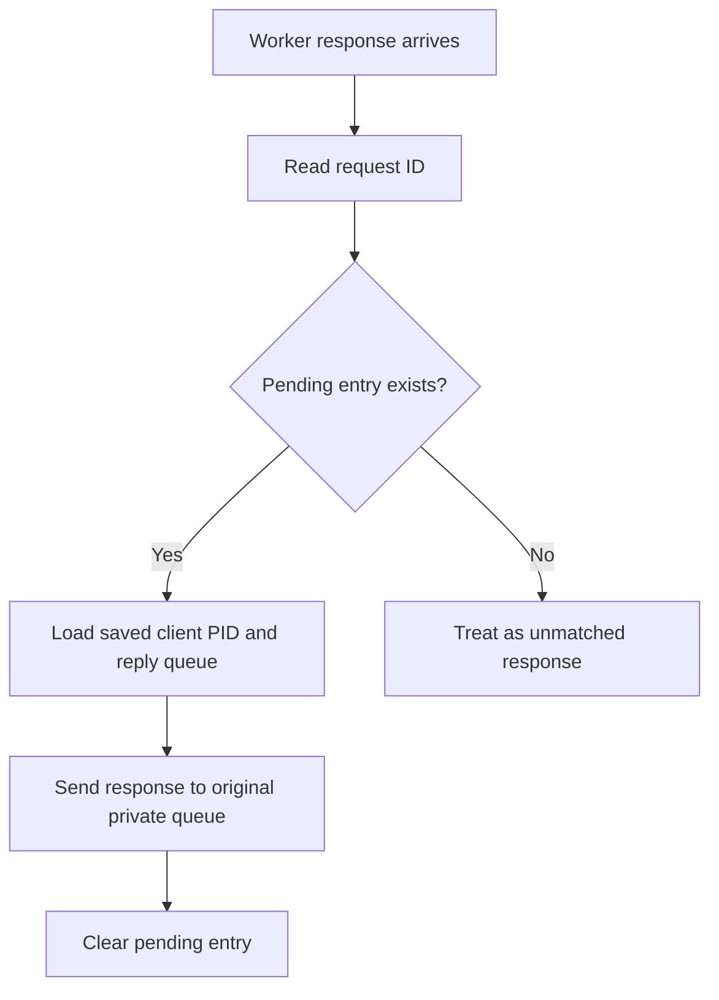
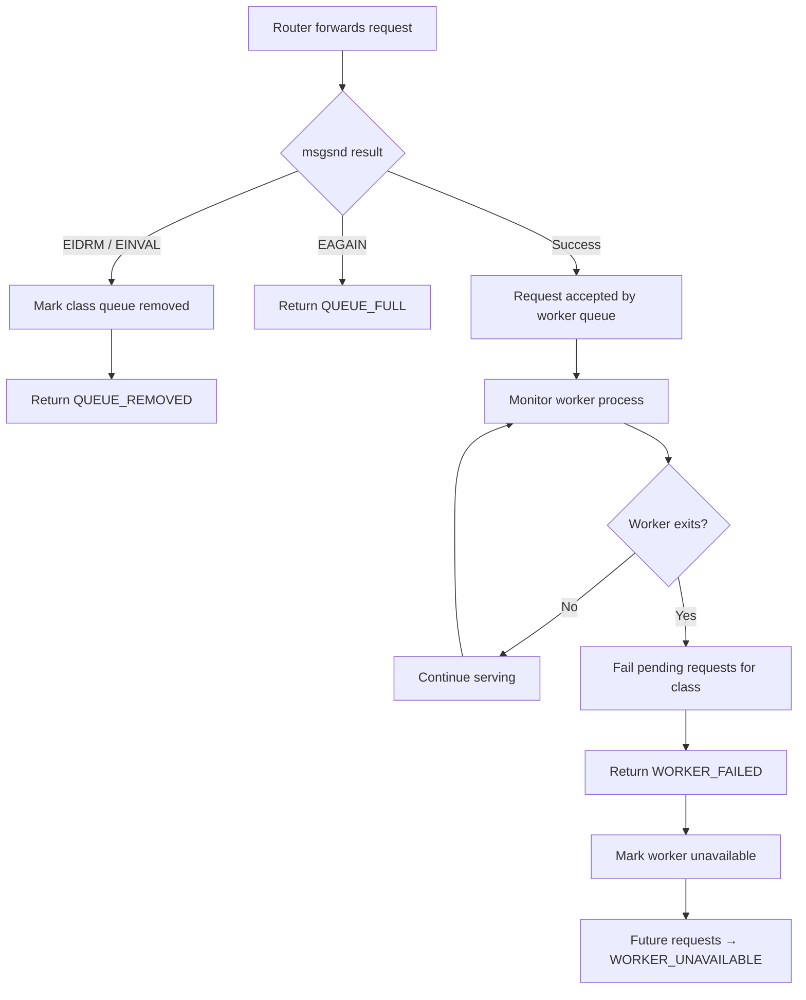
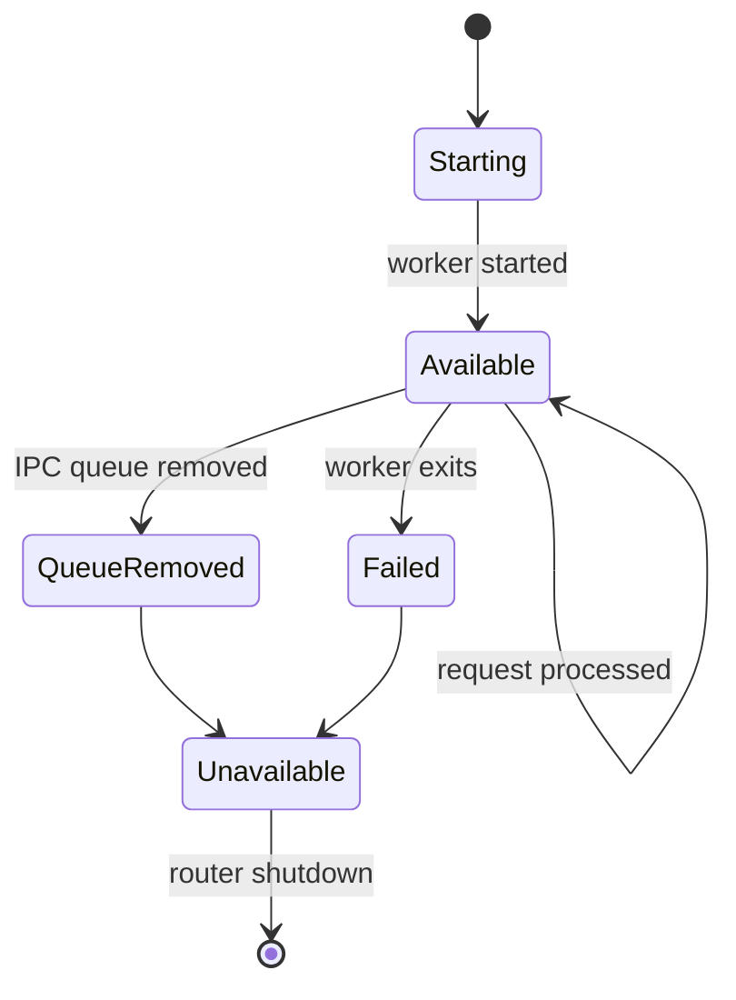
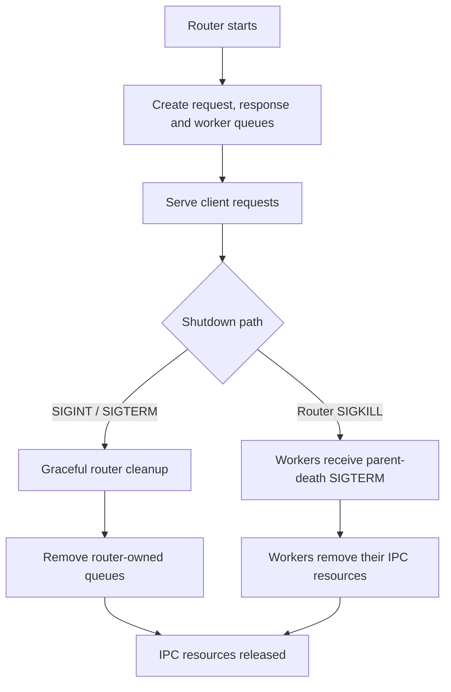

# System V Message-Queue Router
### A priority-aware, fault-isolated IPC system in C

<p align="center">
  <strong>One router · Three worker classes · Private client replies · Supervised processes</strong>
</p>

<p align="center">
  <a href="#quick-start">Quick start</a> · <a href="#architecture">Architecture</a> · <a href="#protocol">Protocol</a> · <a href="#testing">Testing</a> · <a href="#troubleshooting">Troubleshooting</a>
</p>

A Linux systems-programming project demonstrating **System V message queues, process management, message validation, request correlation, priority scheduling, IPC permissions and worker-failure recovery**.

The router accepts requests from independent clients, validates each message, dispatches it to an isolated worker process and returns the result only to the private reply queue registered for that request. A failed worker is isolated: the other classes can continue serving requests.

---

## Contents

- [At a glance](#at-a-glance)
- [Quick start](#quick-start)
- [Features](#features)
- [Architecture](#architecture)
- [Request lifecycle](#request-lifecycle)
- [Priority scheduling](#priority-scheduling-and-system-v-message-type-semantics)
- [Protocol](#protocol)
- [Validation and security](#validation-and-security)
- [Failure handling](#failure-handling)
- [Build and run](#build-and-run)
- [Testing](#testing)
- [Statistics and observability](#statistics-and-observability)
- [IPC resources and permissions](#ipc-resources-and-permissions)
- [Project structure](#project-structure)
- [Implementation notes](#implementation-notes)
- [Troubleshooting](#troubleshooting)
- [Learning outcomes](#learning-outcomes)
- [Presentation walkthrough](#presentation-walkthrough)

---

## At a glance

| Area | Design |
|---|---|
| Language | C (C11) |
| Platform | Linux |
| IPC | System V message queues |
| Process model | Router + 3 workers + independent clients |
| Request classes | Standard, Priority, Batch |
| Routing key | System V message type (`mtype`) |
| Response correlation | Router-owned pending-request table |
| Queue sends | Non-blocking |
| Worker supervision | `waitpid()` |
| IPC permissions | `0600` |
| Build checks | GCC warnings-as-errors, AddressSanitizer, UndefinedBehaviorSanitizer |

### Worker classes

| Class | Message type | Worker | Intended workload |
|---|---:|---|---|
| **STANDARD** | `1` | Standard worker | Normal requests |
| **PRIORITY** | `2` | Priority worker | Time-sensitive requests |
| **BATCH** | `3` | Batch worker | Background/bulk requests |

### Core guarantees

- Every accepted request has a request ID and a registered private reply queue.
- Workers cannot choose or replace the client's reply destination.
- Malformed messages are rejected before forwarding.
- A full worker queue returns `QUEUE_FULL` rather than blocking the router.
- A failed or removed worker affects its own class, not the whole router.
- Graceful shutdown removes router-owned IPC resources.
- Workers use a parent-death signal for additional cleanup if the router is killed abruptly.

---

## Quick start

### 1. Clone

```bash
git clone https://github.com/abhishekpasupathy/unixassigment2.git
cd unixassigment2
```

### 2. Build

```bash
make
```

### 3. Start the router

In terminal 1:

```bash
./mq_router router
```

Keep it running. Startup output includes the router PID, shared queue IDs and each worker's PID, queue ID and message type.

### 4. Send requests

In terminal 2:

```bash
./mq_router client standard "Generate monthly report"
./mq_router client priority "Process urgent payment"
./mq_router client batch "Archive daily records"
```

### 5. Run tests

With the router still running:

```bash
./mq_router test
make demo
```

### 6. Stop the router

```bash
kill -TERM <router-pid>
```

---

## Features

<details>
<summary><strong>Request routing and worker isolation</strong></summary>

Three independent worker processes each have their own System V input queue. The router selects a worker based on the request class and forwards validated work to that queue.

</details>

<details>
<summary><strong>Priority-first polling</strong></summary>

The router polls message type 2 explicitly before receiving from the remaining known message types. This is necessary because a negative System V receive type selects the lowest eligible message type, not the highest.

</details>

<details>
<summary><strong>Defensive protocol validation</strong></summary>

The router validates message size, magic marker, protocol version, class/type agreement, identifiers, payload length and NUL termination before forwarding.

</details>

<details>
<summary><strong>Private response routing</strong></summary>

The router stores request ID, client PID, class and reply queue ID in a pending table. Workers return the request ID; the router chooses the destination using its own saved record.

</details>

<details>
<summary><strong>Worker supervision and cleanup</strong></summary>

The router monitors children with `waitpid()`. Workers configure `PR_SET_PDEATHSIG` so they can clean up their IPC resources if the parent dies unexpectedly.

</details>

<details>
<summary><strong>Observability and repeatable tests</strong></summary>

`SIGUSR1` prints live per-client counters. The Makefile includes normal build, test, demo, sanitizer and cleanup targets.

</details>

---

## Architecture

The application has three layers:

1. **Client layer** — creates a private reply queue and submits a request.
2. **Router layer** — validates, schedules, forwards, correlates responses and supervises workers.
3. **Worker layer** — processes requests independently and returns results.

### System overview



### Queue topology



### Why separate worker queues?

- Independent processing paths and queue capacity.
- Isolation when one worker is slow, removed or unavailable.
- Explicit per-class queue-pressure behavior.
- Straightforward supervision and failure reporting.
- A clear extension point for adding more worker classes.

---

## Request lifecycle



| Stage | Responsibility | Key property |
|---|---|---|
| Create | Client creates private reply queue | Unique destination |
| Submit | Client sends request | Class represented by `mtype` |
| Validate | Router checks the message | Invalid data is not forwarded |
| Register | Router records pending request | Request ID maps to trusted destination |
| Dispatch | Router sends to worker queue | Non-blocking send |
| Execute | Worker processes payload | Process isolation |
| Respond | Worker sends request ID and result | No destination queue supplied by worker |
| Deliver | Router resolves pending entry | Original reply queue is used |
| Complete | Client validates response | Request ID must match |

---

## Priority scheduling and System V message-type semantics

The project keeps the required mapping:

- `1 = STANDARD`
- `2 = PRIORITY`
- `3 = BATCH`

**Important System V detail:** a negative `msgtyp` passed to `msgrcv()` does not mean “highest numeric type first.” A negative value selects the message with the **lowest message type** that is less than or equal to its absolute value.

Therefore, a single `msgtyp = -3` receive could select type 1 (STANDARD) before type 2 (PRIORITY).

### Strategy implemented

1. Poll exact type `2` first.
2. If no priority message is available, use a negative receive for the remaining known types.
3. Use a type-zero receive as a final catch-all so unexpected positive types can be consumed and rejected rather than left stuck in the queue.



> This is priority-first polling, not preemptive scheduling. A request already being processed by a worker is not interrupted when a new priority request arrives.

---

## Protocol

The protocol uses structured C message bodies carried by System V queues. A System V message structure begins with a `long` message type. The size passed to `msgsnd()` and `msgrcv()` excludes that leading `long`.

### Request metadata

| Field / concept | Purpose |
|---|---|
| `mtype` | Selects the class on the request queue |
| Magic marker | Identifies messages belonging to this protocol |
| Version | Supports protocol compatibility checks |
| Class identifier | Must agree with the request message type |
| Client PID | Associates activity and statistics with a client |
| Request ID | Correlates the response with the original request |
| Reply queue ID | Identifies the client's private reply queue |
| Payload length | Bounds the payload that may be read |
| Payload | Application data; must be correctly terminated |

### Response routing

Workers return a request ID and result metadata on the shared response queue. They do **not** provide a destination queue ID.



The router, not the worker, controls where a response is delivered.

---

## Validation and security

Queue messages are treated as untrusted input. The router checks:

- Minimum and maximum message size.
- Magic marker and protocol version.
- Valid class identifier.
- Agreement between class identifier and System V message type.
- Valid client PID and request ID.
- Reply queue identifier.
- Payload length and NUL termination.
- Worker response request ID against the pending table.

### Oversized-message handling

The receive buffer is sized to detect an over-limit message safely. The receive operation uses a buffer with an extra byte and `MSG_NOERROR` so an oversized message can be consumed and rejected without writing beyond the allocated buffer.

### Trust boundary


All queues are created with restrictive mode `0600` permissions.

---

## Failure handling

The router distinguishes between queue pressure, removed IPC resources and a worker process that has exited.

### Failure decision flow



### Failure behavior matrix

| Condition | Result | Effect on other classes |
|---|---|---|
| Worker queue is full | `QUEUE_FULL` | None |
| Worker queue is removed | `QUEUE_REMOVED` | None |
| Worker exits unexpectedly | `WORKER_FAILED` for in-flight requests | Other workers continue |
| Request sent to dead worker class | `WORKER_UNAVAILABLE` | Other workers continue |
| Client reply queue disappears | Delivery failure logged; pending entry cleared | None |
| Client receives no reply | Client timeout after 12 seconds | None |
| Invalid request | Rejection response | None |
| Router receives `SIGTERM` | Graceful cleanup | Router shuts down |
| Router receives `SIGKILL` | Workers receive parent-death `SIGTERM` | Workers attempt IPC cleanup |

### Worker state model



### Queue-full behavior

Worker sends are non-blocking. If the kernel reports `EAGAIN`, the router returns `QUEUE_FULL`. It does not wait indefinitely for a queue slot.

The `SLOW` payload sleeps for two seconds in a worker to make queue pressure reproducible during the demo.

---

## Build and run

### Requirements

- Linux with System V IPC support.
- GCC with C11 support.
- GNU Make.
- `ipcrm` and `ipcs` for IPC inspection and cleanup.
- `runuser` and a `nobody` account for the optional permission demonstration.

The worker parent-death cleanup uses Linux `prctl(PR_SET_PDEATHSIG, SIGTERM)`.

### Standard build

```bash
make
```

Equivalent compiler command:

```bash
gcc -std=c11 -Wall -Wextra -Wpedantic -Werror -O2 \
  -o mq_router mq_router.c
```

The default build treats compiler warnings as errors.

### Start the router

```bash
./mq_router router
```

### Send requests

```bash
./mq_router client standard "Normal task"
./mq_router client priority "Urgent task"
./mq_router client batch "Background task"
```

### Simulate a slow worker

```bash
./mq_router client standard SLOW
```

### Run malformed-message tests

```bash
./mq_router test
```

### Sanitizer build

```bash
make asan
ASAN_OPTIONS=detect_leaks=0 ./mq_router_asan router
```

AddressSanitizer helps detect memory errors; UndefinedBehaviorSanitizer helps detect undefined behavior. Run the client tests against the sanitizer-enabled router while it is active.

### Make targets

| Target | Purpose |
|---|---|
| `make` / `make all` | Compile the standard executable |
| `make run` | Start the router |
| `make test` | Run malformed-message tests (router must be running) |
| `make demo` | Run the full end-to-end demonstration |
| `make asan` | Build with AddressSanitizer and UndefinedBehaviorSanitizer |
| `make clean` | Remove executables and generated logs |

---

## Testing

### Malformed-message test suite

Start the router, then run:

```bash
./mq_router test
```

The test command submits seven invalid messages:

| # | Test case | Expected behavior |
|---:|---|---|
| 1 | Wrong magic marker | Reject |
| 2 | Wrong protocol version | Reject |
| 3 | Unknown class identifier | Reject |
| 4 | Short message | Reject |
| 5 | Oversized message | Reject safely |
| 6 | Missing NUL terminator | Reject |
| 7 | Unexpected message type (`mtype = 99`) | Consume and reject |

The test client waits for rejection responses and confirms each case.

### Full end-to-end demonstration

```bash
make demo
```

The demo performs these steps:

1. Routes one standard, one priority and one batch request.
2. Runs all seven malformed-message cases.
3. If run as root with `runuser` available, attempts a request as `nobody` and demonstrates `EACCES` against the mode-`0600` queue.
4. Starts a `SLOW` standard request, then launches 120 concurrent clients to create queue pressure.
5. Removes the batch worker queue using `ipcrm -q`.
6. Starts a `SLOW` priority request and terminates that worker using `kill -9`.
7. Confirms the in-flight priority request receives `WORKER_FAILED` and later requests receive `WORKER_UNAVAILABLE`.
8. Confirms standard requests still work, requests a statistics snapshot and shuts down the router.

### Expected outcomes

| Scenario | Expected observation |
|---|---|
| Normal requests | Successful response from each class |
| Malformed inputs | Seven rejections |
| Queue saturation | Success or explicit `QUEUE_FULL` |
| Removed batch queue | `QUEUE_REMOVED` |
| Killed priority worker | `WORKER_FAILED` for in-flight work |
| Later priority request | `WORKER_UNAVAILABLE` |
| Standard request after priority failure | Still succeeds |
| Unauthorized queue access | `EACCES` |
| Graceful shutdown | Router-owned queues removed |

The exact split between successful requests and `QUEUE_FULL` depends on process scheduling and machine load. The important property is a bounded, explicit outcome rather than clients hanging indefinitely.

---

## Statistics and observability

Send `SIGUSR1` to the router process:

```bash
kill -USR1 <router-pid>
```

The router prints a live statistics snapshot. A final report is also printed during shutdown.

| Counter | Meaning |
|---|---|
| `received` | Requests received for an identifiable client |
| `forwarded` | Requests successfully forwarded to a worker |
| `completed` | Worker responses successfully correlated/completed |
| `rejected` | Invalid or rejected requests |
| `failed` | Requests that failed during forwarding or worker processing |
| `unidentified_rejections` | Malformed messages for which client metadata cannot safely be identified |

Statistics are keyed by client PID. Unidentified rejections are counted separately because malformed input may not contain trustworthy client metadata.

---

## IPC resources and permissions

All project queues are created with restrictive permissions: **`0600`**.

| Queue | Creation | Purpose |
|---|---|---|
| Router request queue | Fixed key `0x52545232`, `IPC_CREAT | IPC_EXCL` | Client-to-router requests |
| Standard worker queue | `IPC_PRIVATE` | Standard work |
| Priority worker queue | `IPC_PRIVATE` | Priority work |
| Batch worker queue | `IPC_PRIVATE` | Batch work |
| Router response queue | `IPC_PRIVATE` | Worker-to-router responses |
| Client reply queue | `IPC_PRIVATE` | Private response destination |

Worker queues use a small capacity (1024 bytes) to make queue-full behavior demonstrable.

### Inspect queues

```bash
ipcs -q
```

### Remove a stale request queue

Only do this when no router is currently running:

```bash
./mq_router cleanup
```

To remove a specific queue manually:

```bash
ipcrm -q <queue-id>
```

> Do not remove queue IDs belonging to an active router unless you are intentionally testing queue-removal behavior.

### Cleanup lifecycle



---

## Project structure

```text
unixassigment2/
├── mq_router.c   # Router, workers, clients, protocol, validation and tests
├── Makefile      # Build, run, test, demo, sanitizer and clean targets
├── demo.sh       # End-to-end routing and failure demonstration
├── .gitignore    # Generated binaries and logs
└── README.md     # Project documentation
```

| File | Responsibility |
|---|---|
| `mq_router.c` | Router, worker, client, message protocol, validation, statistics and supervision |
| `Makefile` | Repeatable compiler and test commands |
| `demo.sh` | Routing, overload, permission and worker-failure demonstration |
| `.gitignore` | Excludes generated executables and logs |
| `README.md` | Architecture, protocol, commands and design decisions |

---

## Implementation notes

### 1. Pending-request table

The pending table is the router's source of truth for response destinations. When a request is accepted, the router records its request ID, client PID, class and private reply queue ID. When a worker responds, the router resolves the request ID and uses the saved destination.

This prevents a worker from redirecting a response to an arbitrary queue.

### 2. Non-blocking dispatch

A full worker queue should not freeze the router. Non-blocking sends convert queue pressure into a protocol-level `QUEUE_FULL` response.

### 3. Worker supervision

The router checks child process status with `waitpid()`. When a worker exits, pending requests assigned to that class are failed and the class is marked unavailable. The other workers continue running.

### 4. Parent-death cleanup

Each worker configures `PR_SET_PDEATHSIG` so unexpected parent death causes the worker to receive `SIGTERM`. The worker then removes its own queue and shared IPC queues through the cleanup path.

### 5. Shared response queue

Workers do not need to know about individual client queues. They return a compact response containing the request ID. The router performs correlation and delivery.

### 6. Oversized-message detection

A receive buffer one byte larger than the valid protocol body lets the router distinguish an over-limit message from a valid maximum-sized message. The oversized message can be consumed and rejected without writing beyond the allocated buffer.

---

## Troubleshooting

<details>
<summary><strong><code>make</code> reports that a compiler is missing</strong></summary>

Install GCC and Make using your Linux distribution's package manager, then rerun `make`.

</details>

<details>
<summary><strong>The router says the request queue already exists</strong></summary>

A previous run may have exited without cleanup. Check active processes and queues:

```bash
pgrep -af mq_router
ipcs -q
```

If no router is active, remove the stale well-known queue:

```bash
./mq_router cleanup
```

</details>

<details>
<summary><strong>A client reports a timeout</strong></summary>

Confirm the router is running and inspect its output. A client waits up to 12 seconds. Check whether the worker is slow, unavailable or the reply queue was removed.

</details>

<details>
<summary><strong>A request returns <code>QUEUE_FULL</code></strong></summary>

This is an intentional overload response. The worker queue is full and the router refuses to block. Retry after the worker has processed queued requests.

</details>

<details>
<summary><strong>A request returns <code>WORKER_UNAVAILABLE</code></strong></summary>

That worker class has exited or its queue has been removed. Other worker classes are designed to continue independently. Restart the router to recreate all workers.

</details>

<details>
<summary><strong>The permission test does not run</strong></summary>

The optional permission test requires root privileges, `runuser` and a `nobody` account. The rest of the demo can still run without this optional check.

</details>

<details>
<summary><strong>How do I check for leftover message queues?</strong></summary>

```bash
ipcs -q
```

Remove only stale queue IDs you own and have confirmed are not used by an active process.

</details>

---

## Learning outcomes

This project provides practical experience with:

- **System V IPC:** `msgget()`, `msgsnd()`, `msgrcv()`, `msgctl()`.
- **Unix process management:** `fork()`, `waitpid()`, signals and process lifecycle.
- **Message-oriented design:** message types, request IDs, response correlation and queue permissions.
- **Defensive C programming:** bounded buffers, validation, error paths and sanitizers.
- **Concurrency:** independent clients, worker processes and queue saturation.
- **Fault tolerance:** worker supervision, pending-request failure and class isolation.
- **Operating-system observability:** `ipcs`, `ipcrm`, process inspection and signal-driven statistics.

### Course outcome mapping

| Outcome | Demonstrated work |
|---|---|
| CO4 / CO5 | IPC, process coordination, error handling and fault isolation |
| PO2 | Analyze and validate incoming requests |
| PO3 | Design a modular, table-driven routing solution |
| PO5 | Apply System V IPC, message types, permissions and Unix process tools |
| PO9 | Demonstrate independent client/worker interaction and coordination |
| SDG 9 | Reliable infrastructure through queue-based routing and failure handling |
| SDG 16 | Controlled access through permissions, validation and process isolation |

---

## Presentation walkthrough

For a short lab or project presentation:

1. Explain the three client classes and their message types.
2. Start the router and identify request, response and worker queue IDs.
3. Send one request through each class.
4. Explain how the pending table routes responses to private client queues.
5. Run the malformed-message tests.
6. Run the demo to show queue saturation and worker-failure isolation.
7. Trigger `SIGUSR1` and explain the statistics.
8. Finish by showing graceful cleanup and `ipcs -q`.

---

## System calls and references

| Interface | Role |
|---|---|
| `msgget(2)` | Create or access a message queue |
| `msgsnd(2)` | Send a message |
| `msgrcv(2)` | Receive a message using message-type selection |
| `msgctl(2)` | Inspect or remove a queue |
| `fork(2)` | Create worker processes |
| `waitpid(2)` | Supervise worker termination |
| `kill(2)` | Deliver signals to processes |
| `prctl(2)` | Configure Linux parent-death signal behavior |

Useful manual pages:

```bash
man 2 msgget
man 2 msgsnd
man 2 msgrcv
man 2 msgctl
man 2 fork
man 2 waitpid
man 2 prctl
```

---

## Repository

**Source:** [github.com/abhishekpasupathy/unixassigment2](https://github.com/abhishekpasupathy/unixassigment2)

- [Router implementation](https://github.com/abhishekpasupathy/unixassigment2/blob/main/mq_router.c)
- [Build configuration](https://github.com/abhishekpasupathy/unixassigment2/blob/main/Makefile)
- [End-to-end demo](https://github.com/abhishekpasupathy/unixassigment2/blob/main/demo.sh)

<p align="center">
  <strong>Reliable, validated and fault-isolated inter-process communication in C.</strong>
</p>
